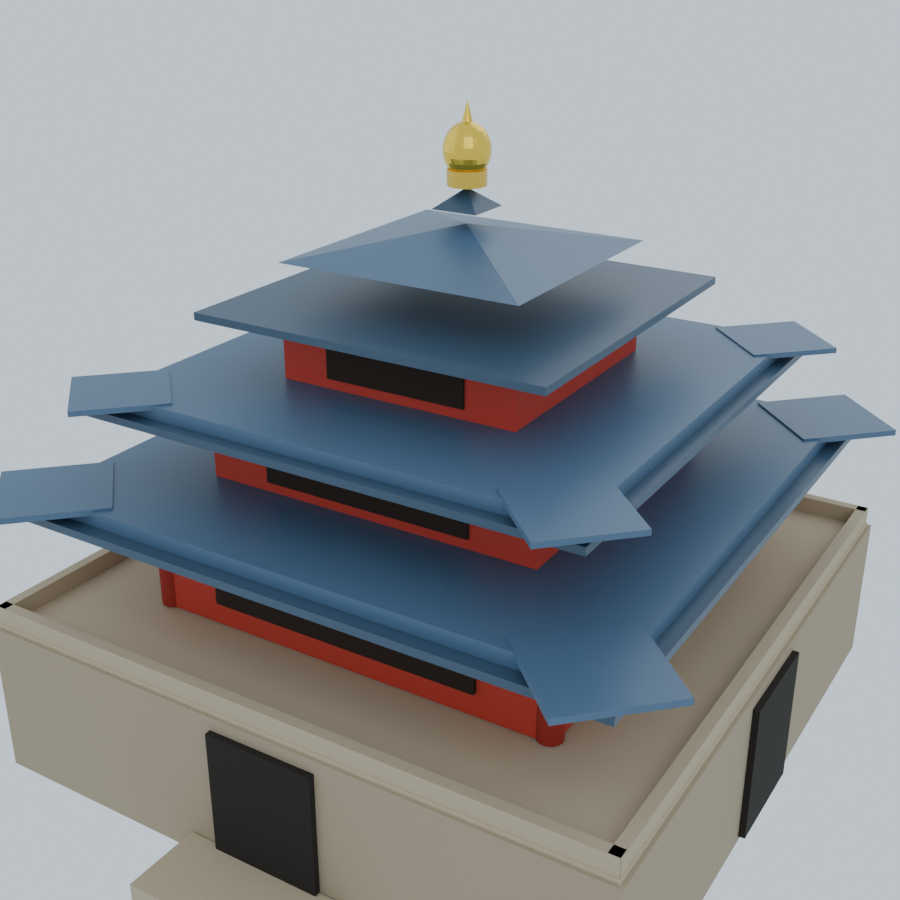
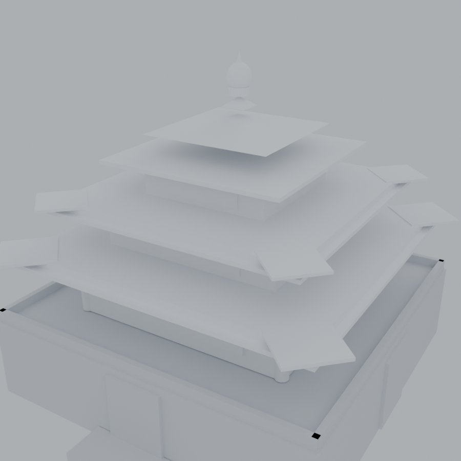

# dsh-blender-bridge

> 把本地 Blender 接进 [DeepSeek Harness](https://github.com/deepseek-ai)：在对话里说「建一个…的模型」，
> agent 就会真的在 Blender 里建模、渲染，并在侧边栏里给你一个**可以用鼠标转的 3D 视口**。


| 完整版（带材质） | 白模（仅几何） |
|---|---|
|  |  |

---

## 特性

- **真建模，不是画图**：调用本地 `blender.exe --background` 执行几何、材质、灯光、相机与 Cycles 渲染，产出真实的 `.blend` 工程文件。
- **3D 视口**：每个任务都会额外导出一份 `scene.glb`，侧边栏面板用 three.js 渲染——左键环绕、滚轮缩放、右键平移。
- **侧边栏标签**：在 DSH 右侧栏注册一个常驻的 **Blender** 标签页，建模过程与结果实时刷新。
- **白模一键生成**：同一份几何，材质全替换为白灰，用来检查形体与比例。
- **产物可追溯**：每个 job 是一个独立目录，含 `spec.json`（参数配方）、`scene.blend`、`scene.glb`、`preview.png`。

---

## 安装

```powershell
# 1. 取得源码
git clone https://github.com/Stook-404/dsh-blender-bridge.git D:\Tools\dsh-blender-bridge

# 2. 装进 DSH 的 profile（把 <profile> 换成你的 profile 名，通常是 desktop）
dsh plugin --profile <profile> add file:D:/Tools/dsh-blender-bridge

# 3. 重启 DSH
```

Blender 不在默认位置时，设环境变量：

```powershell
setx BLENDER_EXE "C:\Program Files\Blender Foundation\Blender 4.2\blender.exe"
```

> 插件默认按 `D:\Blender\blender.exe` → `%ProgramFiles%\Blender Foundation\**` 的顺序自动探测，
> 也可以用 `BLENDER_EXE` 显式指定。

---

## 使用

在对话里直接说：

```
建一个西安钟楼的模型
做一个低多边形的小房子，带红色屋顶
从东南 45° 低角度再渲一张
```

agent 会把需求拆成基本几何体（cube / sphere / cylinder / cone / torus / plane / circle）并调用 `blender_build`。

### 工具 API

#### `blender_build`

| 字段 | 说明 |
|---|---|
| `objects[].type` | `cube` / `sphere` / `cylinder` / `cone` / `torus` / `plane` / `circle` |
| `objects[].name` | 对象名，便于在面板里辨认 |
| `objects[].location` | `[x, y, z]`，单位米 |
| `objects[].scale` | `[x, y, z]` |
| `objects[].rotation` | `[rx, ry, rz]`，弧度 |
| `objects[].radius` | 球 / 柱 / 锥的半径 |
| `objects[].color` | `#RRGGBB` |
| `objects[].metallic` / `roughness` | 0–1 |
| `title` | 面板显示的任务标题 |
| `ground` | 是否加地面（默认 false） |
| `width` / `height` / `samples` | 渲染尺寸与 Cycles 采样（默认 720/720/32） |

返回：`jobId`、`preview`、`blend`、`glb`、`objectCount`、`durationMs`。

#### `blender_status`

列出最近任务（状态 / 标题 / 对象数 / 耗时 / 产物路径）。

---

## 面板

服务端把路由挂在宿主 `webServer` 上：

```
http://127.0.0.1:19387/blender-bridge/panel    ← 可视化面板
http://127.0.0.1:19387/blender-bridge/jobs     ← JSON 任务列表
http://127.0.0.1:19387/blender-bridge/preview/<相对路径>
```

面板每 2 秒轮询一次；只有任务列表真正变化时才重建 DOM，所以正在旋转的视角不会被打断。

### 3D 视口

| 操作 | 效果 |
|---|---|
| 左键拖拽 | 环绕旋转（OrbitControls） |
| 滚轮 | 推拉缩放 |
| 右键拖拽 | 平移 |
| 双击画布 | 复位视角 |
| 右下角 `⤢` `⌂` `⟳` | 复位 / 正视图 / 自动旋转 |

建模结束后 `build_scene.py` 会用 `bpy.ops.export_scene.gltf` 额外导出 `scene.glb`，
面板通过 `/blender-bridge/preview/<job>/scene.glb` 取回并渲染。

three.js 以 importmap 方式从 `unpkg.com` 加载（three@0.160.0）。**完全离线时 3D 视口不可用**，
面板会自动回退成静态 `preview.png`——功能不受影响，只是不能转。

模型加载后会自动按包围盒取景、把底面落到 `y = 0`，并铺一张网格地面便于判断尺度。

---

## 侧边栏标签

插件会在 DeepSeek Harness 右侧栏注册一个 **Blender** 标签页，内容即 `/blender-bridge/panel` 面板。

### 宿主脚本需要的两段注册

```js
ctx.inject(['sidebarRightTabs', 'slots'], (owner) => {
  const tabs  = owner.get('sidebarRightTabs')
  const slots = owner.get('slots') || owner.slots

  // ① tab 类型：决定右侧栏菜单里出现什么
  tabs.register({
    id: 'dsh-blender-bridge',
    kind: 'blender-bridge',
    keepMounted: true,
    title: () => 'Blender',
    guide: [{ id: 'panel', order: 120, title: () => 'Blender', description: () => '用 Blender 建模并预览' }],
  })

  // ② tab 身体：提供渲染组件
  slots.register({ name: 'sidebar.right.pane.tab', key: 'dsh-blender-bridge' }, BlenderPanel)
})
```

### 三个坑（实测）

| 写法 | 结果 | 原因 |
|---|---|---|
| 模块级 `inject: ['slots']` | ❌ 侧边栏无按钮 | 缺该服务的宿主会把插件 park，`apply` 不执行 |
| `ctx.get('slots')` | ❌ `slots === undefined` | 根 ctx 取不到服务 |
| `ctx.inject(['slots'], owner => ...)` | ✅ 可用 | 子 ctx 才有服务 |
| 只注入 `sidebarRightTabs` | ❌ `owner.slots` 为 undefined | 两个服务必须一起注入 |

`guide` 条目缺 `id` 或 `description` 时，标签不会出现在菜单里——这是最隐蔽的一处。

宿主没有右侧栏时，插件仍正常工作：工具与面板 URL 都不受影响。

---

## 架构

```
dsh-blender-bridge/
├─ package.json          插件清单（dsh.bundle.patch / dsh.client）
├─ cordis.patch.yml      挂载点：id=blender-bridge
├─ lib/index.js          服务端：2 个工具 + HTTP 路由 + 系统提示注入
├─ client.js             客户端：注册侧边栏标签（iframe 指向面板）
├─ python/build_scene.py Blender 驱动（几何/材质/灯光/相机/渲染/glTF 导出）
└─ panel.html            可视化面板（three.js 3D 视口）
```

### 产物布局

```
<输出目录>/<jobId>/
├─ spec.json      建模参数（可复现、可手改）
├─ scene.blend    Blender 工程
├─ scene.glb      glTF 模型（面板 3D 视口用）
└─ preview.png    Cycles 渲染图
```

默认输出目录：`~/.dsh/blender-out/`，可用环境变量 `BLENDER_OUT_DIR` 覆盖。

### 实现要点

- **无头建模**：`blender.exe --background --factory-startup --python build_scene.py -- spec.json out.blend out.png`
- **自动取景**：按场景包围盒 + 相机 FOV 计算距离（`dist = radius/2 / tan(fov/2) * fit`）
- **光照**：三盏面光（主光 / 补光 / 轮廓光）+ 世界背景，避免默认全黑
- **材质**：Principled BSDF，颜色做 sRGB → 线性转换
- **渲染**：Cycles CPU + 降噪（无头模式下 EEVEE 需要 GL 上下文，不可靠）
- **编码**：读 spec 用 `utf-8-sig`，容忍 PowerShell 写入的 BOM

---

## 已知限制

1. **EEVEE 不可用**：无头环境请用 `CYCLES`。
2. **几何体组合而非精确建模**：暂不支持布尔、修改器、曲线、导入外部模型。
3. **单进程渲染**：同一时间只跑一个 Blender 任务，大场景受 `timeoutMs`（默认 300s）限制。

## 卸载

```powershell
dsh plugin --profile <profile> remove dsh-blender-bridge
```

产物目录与源码目录需手动删除。

---

## License

[MIT](LICENSE) © Stook-404

模型截图中的西安钟楼为个人学习用途的程序化重建，不涉及任何受版权保护的素材。
